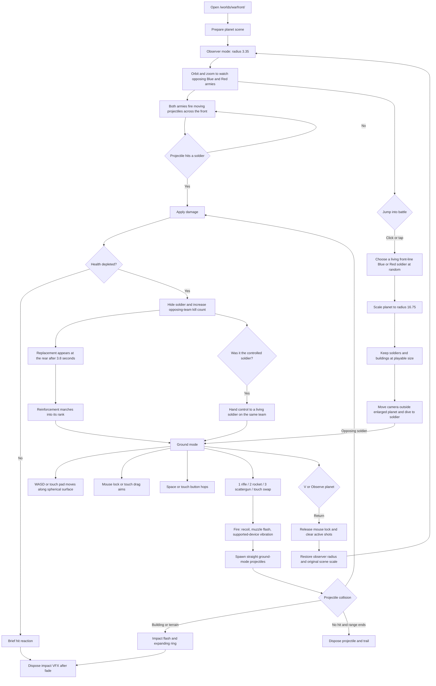

# Warfront flow map

Warfront has one Three.js scene and camera. The observer and soldier states share the same planet data, fighters, renderer, and animation loop. Blue and Red occupy opposite hemispheres. Twelve linked clash sectors follow the great circle between them, with eight reserve sectors on each side. Soldiers stand in two ranks under team banners, and front ranks periodically advance toward one another. Every front-line soldier fires a moving projectile; hits reduce health, create impact VFX, and can eliminate the target. Fallen soldiers return from the rear and march back into formation. A player casualty hands control to a living teammate.

Each soldier carries one of three procedural gun models. The rifle has a stock, magazine, sight, and narrow barrel; the scattergun has twin barrels and a pump; the rocket launcher has a broad tube and sight. NPC weapons are distributed across both teams. Muzzle flashes stay visible briefly after a shot, the carried gun and arm kick back, and projectiles start at each model's muzzle. NPC rifles fire fast rounds, scatterguns fire heavier short-range shots, and rockets fly more slowly with splash damage and a larger impact ring. The player can swap among all three models during ground play.

## Ground scale and movement

| State | Planet radius | Soldier and building size | Projectiles |
| --- | ---: | --- | --- |
| Observer | 3.35 | Original small diorama | AI projectiles with hits and impact effects |
| Ground | 16.75 | Preserved by inverse scaling battle groups | Straight local trajectories |

The globe grows by a factor of five during the jump. Battle groups and the player anchor receive the inverse scale, so characters and buildings keep their playable world size while the terrain becomes much broader. Movement advances the player normal along a spherical arc. The forward direction is parallel transported across that arc, which keeps W and D stable as the surface curves. Buildings push the player around their footprint instead of stopping movement completely.

## Weapon and impact flow

| Input | Weapon | Shot behavior | Feedback |
| --- | --- | --- | --- |
| 1 | Assault rifle | Rapid straight bullets; three hits eliminate | Small recoil, short vibration, blue-white or red trail, compact impact |
| 2 | Rocket launcher | Slower straight rocket; blast damages nearby enemies | Heavy recoil, long vibration pattern, orange trail, large explosion ring |
| 3 | Scattergun | Seven short-range pellets per trigger; each pellet damages | Medium recoil, two-pulse vibration, amber trails and impacts |

Vibration uses the browser's `navigator.vibrate` API when available. Pointer lock applies only to fine-pointer devices. Touch devices retain drag aiming and on-screen controls. Escape unlocks the pointer; clicking the battlefield locks it again. Returning to observer mode restores the original globe and clears ground-only projectiles and impacts.

Procedural Web Audio adds weapon, impact, movement, and reinforcement cues. The observer and ground HUDs share a sound toggle, and the preference is stored locally. Audio starts after a visitor gesture and is disposed when Warfront closes.

## Code ownership

- `src/worlds/warfront/WarfrontVisual.ts`: planet scale, soldier movement, weapons, collisions, feedback, and Three.js resource disposal.
- `src/worlds/warfront/WarfrontAudio.ts`: procedural audio, spatial mixing, sound preference, and audio resource disposal.
- `src/worlds/warfront.ts`: observer and soldier HUD, pointer lock, keyboard and touch input, and score display.
- `src/style.css`: Warfront HUD and touch control presentation.
